# 🎄 FPP Web Control

**Web-Steuerung für den Falcon Player (FPP) – für interaktive Weihnachts- und Lichtershows**

Besucher starten per Smartphone Shows, wünschen sich Lieder, hören die Musik synchron auf dem eigenen Gerät und können spenden. Sie sprechen dabei nur mit dieser Web-App, nie direkt mit dem Falcon Player.

[](https://www.docker.com/)
[](https://www.python.org/)
[](https://flask.palletsprojects.com/)

---

## 📖 Inhaltsverzeichnis

- [Features](#-features)
- [Screenshots](#-screenshots)
- [Schnellstart](#-schnellstart)
- [Konfiguration](#-konfiguration)
- [Zugangsschutz](#-zugangsschutz)
- [Musik auf dem Besucher-Gerät (FalconBeat)](#-musik-auf-dem-besucher-gerät-falconbeat)
- [Benachrichtigungen](#-benachrichtigungen)
- [Deployment](#-deployment)
- [API](#-api)
- [Entwicklung](#-entwicklung)
- [FAQ](#-faq)
- [Lizenz](#-lizenz)

Weitere Dokumente: [ARCHITECTURE.md](ARCHITECTURE.md) (Aufbau), [deploy/README.md](deploy/README.md) (Reverse Proxy), [NOTIFICATIONS.md](NOTIFICATIONS.md) (Benachrichtigungen), [CHANGELOG.md](CHANGELOG.md).

---

## ✨ Features

### Für Besucher

- **Shows starten**: zwei frei benennbare Playlists (z. B. Hauptshow und Kindershow)
- **Lieder wünschen**: Liste aus einer FPP-Playlist, Warteschlange mit Platz und geschätzter Wartezeit, eigene Wünsche sind markiert
- **„Jetzt läuft“**: Titel und Restzeit des aktuellen Lieds stehen oben auf der Seite
- **Musik auf dem eigenen Gerät**: Ein Knopf spielt die Musik synchron zur Lichtershow im Browser ab (benötigt [FalconBeat](#-musik-auf-dem-besucher-gerät-falconbeat))
- **Countdown** zur nächsten geplanten Show mit Showart und Uhrzeit
- **Spenden**: PayPal-Pool und optional „Buy me a Coffee“
- **Für das Handy gebaut**: große Tippflächen, weihnachtliches Design, Unterstützung für Screenreader und „Bewegung reduzieren“

### Für Betreiber

- **Zeitsteuerung**: Saison (Datum) und tägliche Showzeiten, außerhalb sind die Knöpfe gesperrt
- **Zeitplan**: automatische Shows zu frei einstellbaren Uhrzeiten
- **Hintergrund-Effekt**: läuft automatisch, wenn nichts gespielt wird
- **Zugangsschutz**: fester Code oder ein täglich wechselnder Code, den eine Pixel-Matrix am Haus anzeigt
- **Faire Wünsche**: Obergrenzen pro Gerät und für die Warteschlange
- **Statistiken**: Show-Starts und Liedwünsche mit Diagrammen
- **Benachrichtigungen**: MQTT, ntfy, Home Assistant, Webhook
- **Datenschutzfreundlich**: Schriften, Symbole und Bibliotheken werden selbst ausgeliefert, Besucher bauen keine Verbindung zu Google Fonts oder CDNs auf
- **Docker Secrets**: jede Einstellung kann aus einer Datei gelesen werden

---

## 📸 Screenshots

Aufgenommen auf Handybreite mit Beispieldaten.

| Startseite | Während eines Wunschlieds | Wunschliste |
|---|---|---|
| 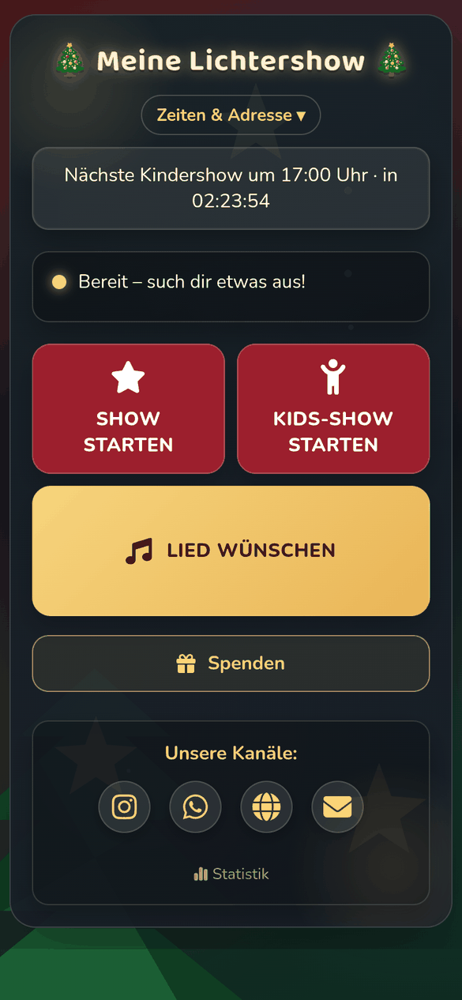 | 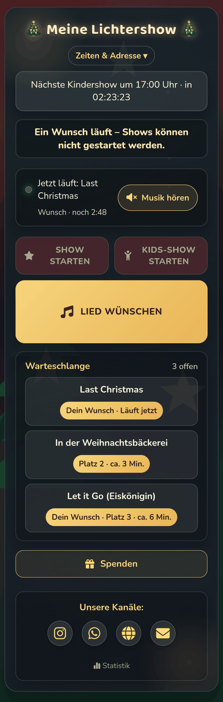 | 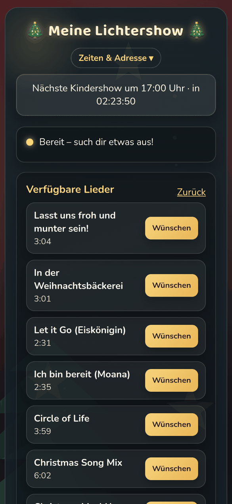 |
| Countdown zur nächsten Show, klare Rangfolge der Knöpfe | Titel und Restzeit, „Musik hören“, eigene Wünsche mit Platz und Wartezeit | Titel aus der Note der FPP-Playlist |

| Tagescode an der Matrix | Außerhalb der Showzeiten | Spenden | Statistik |
|---|---|---|---|
| 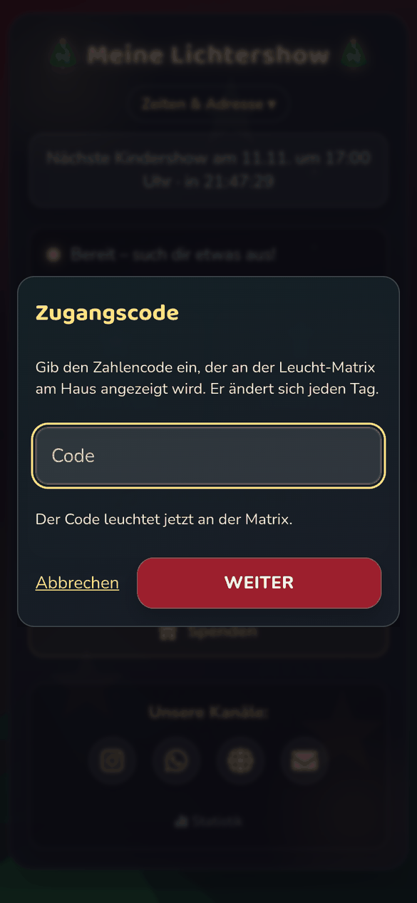 | 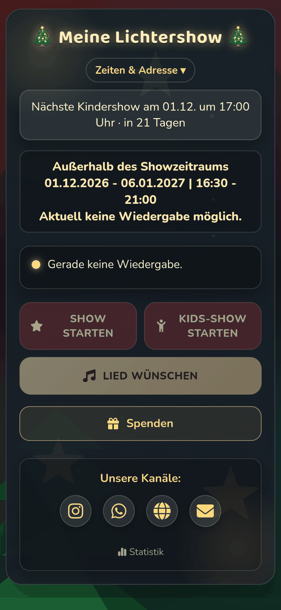 | 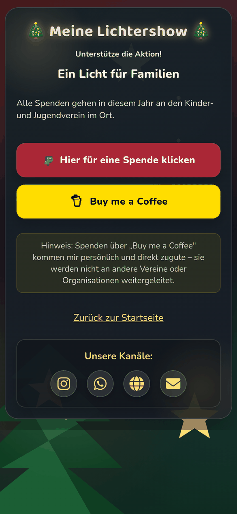 | 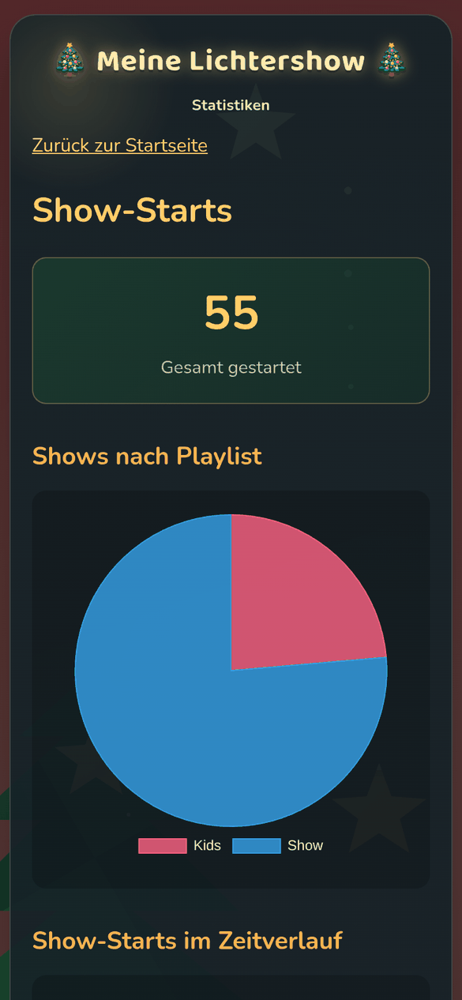 |

---|---|---|---|
| 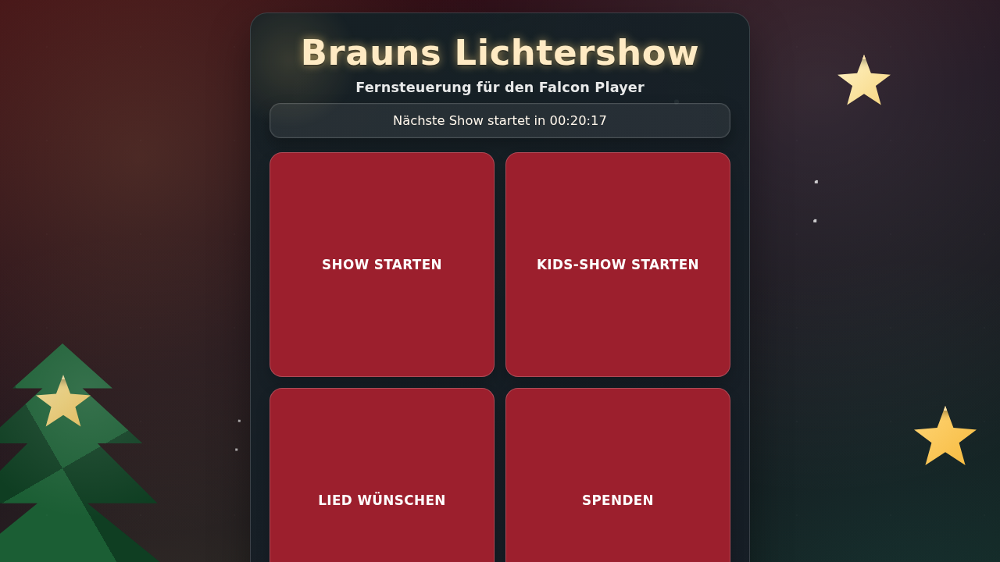 | 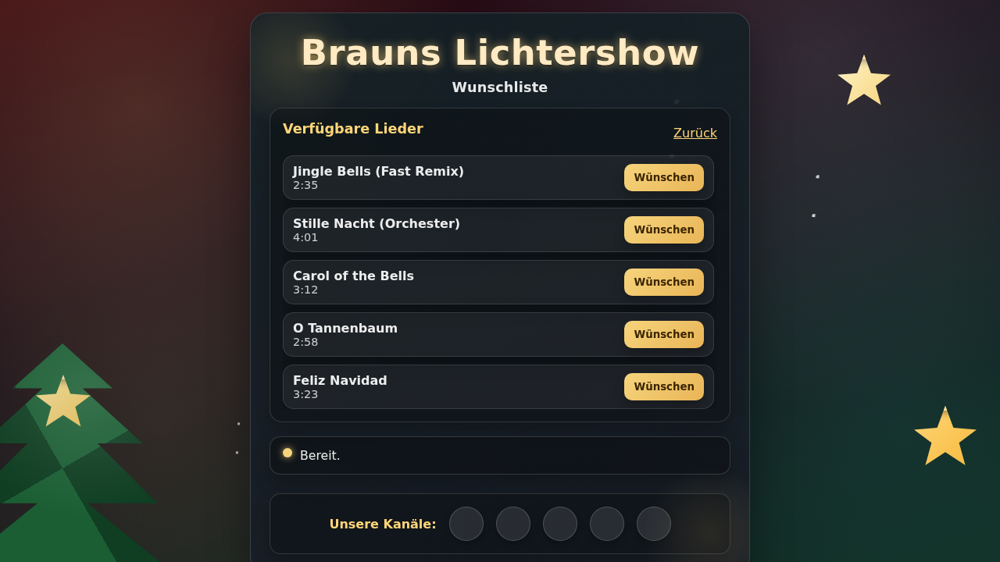 | 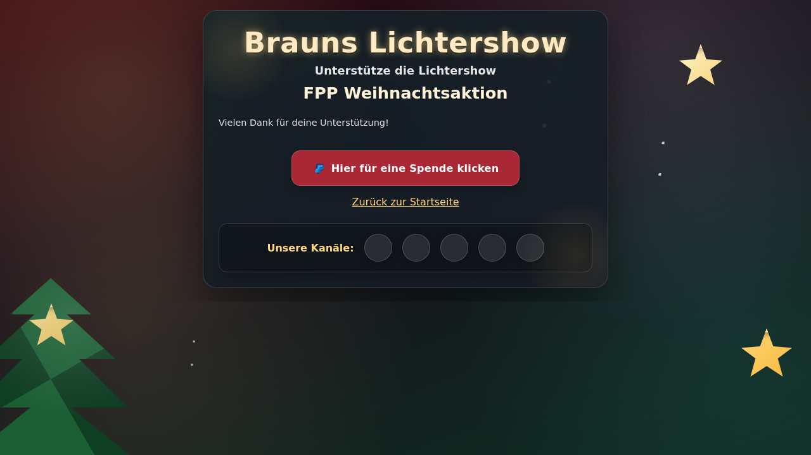 | 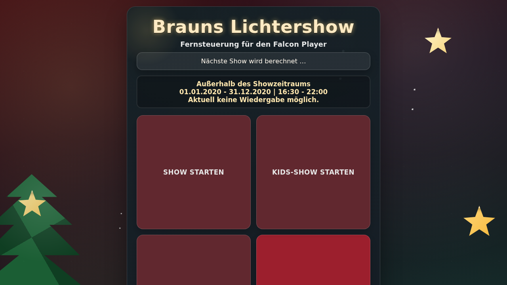 |

---

## 🚀 Schnellstart

### Voraussetzungen

- Docker und Docker Compose
- Ein Falcon Player (FPP), der vom Docker-Host aus erreichbar ist
- Auf dem FPP angelegte Playlists (Show, optional Kindershow, Wunschliste)

### Installation

```bash
git clone https://github.com/TimUx/fpp-web-control.git
cd fpp-web-control
cp .env.example .env
```

In `.env` mindestens diese Werte anpassen:

```bash
SITE_NAME="🎄 Meine Lichtershow 🎄"
FPP_BASE_URL=http://192.168.1.100
FPP_PLAYLIST_1=Show
FPP_PLAYLIST_2=Kids
FPP_PLAYLIST_REQUESTS=wishlist
FPP_SHOW_START_DATE=2026-12-01
FPP_SHOW_END_DATE=2027-01-06
FPP_SHOW_START_TIME=16:30
FPP_SHOW_END_TIME=21:00
ACCESS_CODE=
```

Dann starten und im Browser `http://localhost:8080` öffnen:

```bash
docker compose up -d
```

Ohne `.env` und ohne `config.json` startet der Container mit Standardwerten. Für Docker Swarm siehe [Deployment](#-deployment).

### Titel in der Wunschliste

Als Titel wird die **Note** des Eintrags aus dem FPP-Playlist-Editor angezeigt. Ohne Note erscheint der Name der Sequenz ohne Dateiendung.

---

## 🔧 Konfiguration

Jede Einstellung kann auf drei Wegen gesetzt werden. Bei mehreren Angaben gewinnt die weiter oben stehende:

1. **`config/config.json`** (Schlüssel in der Spalte „config.json“)
2. **Datei per `<VARIABLE>_FILE`**, z. B. `ACCESS_CODE_FILE=/run/secrets/fpp_access_code` (Docker Secrets)
3. **Umgebungsvariable** (Spalte „Variable“)

Die mitgelieferte `docker-compose.yml` lädt die Datei `.env`, in `docker-stack.yml` stehen die Variablen direkt in der Datei (siehe [Deployment](#-deployment)).

Änderungen wirken nach einem Neustart des Containers. Vollständige Beispiele: [`config/config.example.json`](config/config.example.json) und [`.env.example`](.env.example).

### Seite

| Variable | config.json | Beschreibung | Standard |
|---|---|---|---|
| `SITE_NAME` | `siteName` | Name der Show (Überschrift, Tab-Titel) | `FPP Lichtershow` |
| `SITE_SUBTITLE` | `siteSubtitle` | Zeiten und Adresse; Zeilenumbrüche mit `\n`. Außerhalb der Showzeiten offen, während der Showzeiten eingeklappt | `Fernsteuerung für den Falcon Player` |
| `SITE_DESCRIPTION` | `siteDescription` | Kurztext für Suchmaschinen und Link-Vorschauen | siehe Beispiel |
| `SITE_IMAGE_URL` | `siteImageUrl` | Vollständige URL eines Vorschaubilds für geteilte Links | leer |
| `BUTTON_PLAYLIST_1` | `buttonPlaylist1Text` | Text des ersten Show-Knopfs | `Playlist 1 starten` |
| `BUTTON_PLAYLIST_2` | `buttonPlaylist2Text` | Text des zweiten Show-Knopfs | `Playlist 2 starten` |
| `PREVIEW_MODE` | `previewMode` | Vorschau ohne FPP mit Beispieldaten | `false` |

### FPP und Playlists

| Variable | config.json | Beschreibung | Standard |
|---|---|---|---|
| `FPP_BASE_URL` | `fppBaseUrl` | Adresse des FPP | `http://fpp.local` |
| `FPP_PLAYLIST_1` | `playlist1` | Playlist des ersten Show-Knopfs | `show 1` |
| `FPP_PLAYLIST_2` | `playlist2` | Playlist des zweiten Show-Knopfs | `show 2` |
| `FPP_PLAYLIST_REQUESTS` | `playlistRequests` | Playlist mit den wünschbaren Liedern | `all songs` |
| `FPP_BACKGROUND_EFFECT` | `backgroundEffect` | FPP-Effekt, der im Leerlauf läuft (leer = keiner) | `background` |
| `FPP_POLL_INTERVAL_MS` | `fppPollIntervalMs` | Abfrage des FPP im Leerlauf; läuft etwas, wird alle 5 s abgefragt | `15000` |
| `CLIENT_STATUS_POLL_MS` | `clientStatusPollMs` | Abfrage durch den Browser im Leerlauf; läuft etwas, alle 4 s | `10000` |

### Showzeiten

| Variable | config.json | Beschreibung | Standard |
|---|---|---|---|
| `FPP_SHOW_START_DATE` | `showStartDate` | Erster Tag der Saison (`JJJJ-MM-TT`) | leer (kein Limit) |
| `FPP_SHOW_END_DATE` | `showEndDate` | Letzter Tag der Saison | leer (kein Limit) |
| `FPP_SHOW_START_TIME` | `showStartTime` | Tägliche Startzeit (`HH:MM`) | `16:30` |
| `FPP_SHOW_END_TIME` | `showEndTime` | Tägliche Endzeit; danach ist Ruhezeit | `22:00` |
| `SCHEDULED_SHOWS_ENABLED` | `scheduledShowsEnabled` | Automatische Shows nach Zeitplan | `true` |
| `FPP_SHOW_SCHEDULE` | `showSchedule` | Zeitplan, siehe unten | 17:00 Playlist 2, 18–21 Uhr stündlich Playlist 1 |

**Zeitplan:** `UHRZEIT=PLAYLIST`, durch Komma getrennt. Als Playlist `playlist1`, `playlist2` oder den Namen einer FPP-Playlist angeben. Beispiel: `17:00=playlist2,19:00=playlist1`. Shows, die in die Ruhezeit fallen, werden übersprungen. In `config.json` geht auch eine Liste: `[{"time": "17:00", "playlist": "playlist2"}]`.

### Wünsche und Statistik

| Variable | config.json | Beschreibung | Standard |
|---|---|---|---|
| `MAX_WISHES_PER_DEVICE` | `maxWishesPerDevice` | Offene Wünsche pro Gerät, `0` = unbegrenzt | `2` |
| `MAX_QUEUE_LENGTH` | `maxQueueLength` | Länge der Warteschlange, `0` = unbegrenzt | `10` |
| `STATISTICS_RETENTION_DAYS` | `statisticsRetentionDays` | Statistik-Einträge nach N Tagen löschen, `0` = nie | `0` |

### Spenden und Kanäle

| Variable | config.json | Beschreibung |
|---|---|---|
| `DONATION_POOL_ID` | `donationPoolId` | ID des PayPal-Pools |
| `DONATION_CAMPAIGN_NAME` | `donationCampaignName` | Name der Spendenaktion |
| `DONATION_SUBTITLE` | `donationSubtitle` | Untertitel der Spendenseite |
| `DONATION_TEXT` | `donationText` | Beschreibungstext |
| `BUYMEACOFFEE_USERNAME` | `buyMeACoffeeUsername` | Nutzername bei „Buy me a Coffee“ |
| `SOCIAL_FACEBOOK`, `SOCIAL_INSTAGRAM`, `SOCIAL_TIKTOK`, `SOCIAL_WHATSAPP`, `SOCIAL_YOUTUBE`, `SOCIAL_WEBSITE` | `socialFacebook` … `socialWebsite` | Links im Fußbereich (nur `http`/`https`) |
| `SOCIAL_EMAIL` | `socialEmail` | E-Mail-Adresse im Fußbereich |

Die Einstellungen für Zugangsschutz, FalconBeat und Benachrichtigungen stehen in den folgenden Abschnitten.

---

## 🔐 Zugangsschutz

Ohne Zugangsschutz kann jeder, der die Adresse kennt, Shows starten. Es gibt zwei Verfahren, die sich kombinieren lassen. Bei beiden sieht jeder die Seite mit allen Knöpfen; der Code wird erst bei der ersten Aktion in einem Dialog abgefragt. Der Code wird immer vom Server geprüft und steht nie im Quelltext der Seite. Nach 6 falschen Versuchen muss ein Anschluss 10 Minuten warten.

### Fester Code

| Variable | config.json | Beschreibung |
|---|---|---|
| `ACCESS_CODE` | `accessCode` | Fester Zugangscode (leer = aus) |

### Tagescode an der Pixel-Matrix

Eine Pixel-Matrix am Haus zeigt einen Zahlencode, der jeden Tag wechselt. Nur wer davorsteht, kann ihn lesen, und ein Schild muss nie geändert werden.

- Der Code erscheint während der Showzeiten immer dann, wenn nichts läuft, auch kurz zwischen zwei Wunschliedern. Startet etwas, verschwindet er vorher. Laufende Lieder werden nicht gestört.
- Die Seite und alle Knöpfe sind ohne Code sichtbar. Der Code wird erst abgefragt, wenn jemand eine Show starten oder ein Lied wünschen will; danach läuft die Aktion weiter.
- Besucher tippen ihn einmal ein und sind bis Mitternacht freigeschaltet.
- Die Matrix muss in FPP als **Pixel-Overlay-Modell** vorhanden sein.

| Variable | config.json | Beschreibung | Standard |
|---|---|---|---|
| `CODE_MATRIX_MODEL` | `codeMatrixModel` | Name des Overlay-Modells in FPP (leer = aus) | leer |
| `CODE_MATRIX_DIGITS` | `codeMatrixDigits` | Anzahl Ziffern (2–6) | `3` |
| `CODE_MATRIX_COLOR` | `codeMatrixColor` | Farbe der Ziffern (`#RRGGBB`) | `#FFFFFF` |
| `CODE_MATRIX_STRINGS` | `codeMatrixStrings` | Anzahl Strings der Matrix | aus FPP |
| `CODE_MATRIX_STRANDS_PER_STRING` | `codeMatrixStrandsPerString` | Stränge pro String | aus FPP |
| `CODE_MATRIX_ORIENTATION` | `codeMatrixOrientation` | `V` (senkrechte Stränge) oder `H` | aus FPP |
| `CODE_MATRIX_START_CORNER` | `codeMatrixStartCorner` | `TL`, `TR`, `BL` oder `BR` | aus FPP |
| `CODE_SECRET` | `codeSecret` | Geheimnis, aus dem der Code berechnet wird | wird erzeugt und in `data/code_secret` gespeichert |
| `ACCESS_HINT` | `accessHint` | Eigener Hinweistext über dem Eingabefeld | Standardtext |

**Verkabelung:** Die vier Verkabelungswerte sind nur nötig, wenn FPP das Modell anders beschreibt, als die Matrix gebaut ist. xLights lädt z. B. eine Matrix aus 3 Strings mit je 12 senkrechten Strängen gern als „300 × 3“ hoch. Die Ziffern werden deshalb von der App selbst gezeichnet (5×7-Raster, so groß wie möglich). Eine Matrix mit 36 × 25 Pixeln zeigt drei Ziffern gut lesbar.

**Vorab testen:** Das Werkzeug zeigt eine Zahl für einige Sekunden und gibt die Matrix danach wieder frei. Mit `--dry-run` gibt es nur ein Textbild aus und schaltet keine Lichter.

```bash
python code_matrix.py --fpp http://192.168.1.100 --model Matrix --text 123 \
    --strands-per-string 12 --orientation V --seconds 20
```

Steht die Zahl gespiegelt oder auf dem Kopf, Startecke oder Ausrichtung anpassen.

---

## 🔊 Musik auf dem Besucher-Gerät (FalconBeat)

Ist auf dem FPP das Plugin [fpp-plugin-FalconBeat](https://github.com/GraphicHealer/fpp-plugin-FalconBeat) installiert und aktiv und läuft ein [FalconBeat-Server](https://github.com/GraphicHealer/FalconBeat), erscheint bei laufender Show der Knopf „Musik hören“. Ein Tipp spielt die Musik synchron zur Lichtershow im Browser ab. Die separate FalconBeat-Seite muss niemand öffnen.

| Variable | config.json | Beschreibung | Standard |
|---|---|---|---|
| `FALCONBEAT_MODE` | `falconbeatMode` | `auto` = anbieten, wenn das Plugin aktiv ist; `on` = Plugin-Prüfung überspringen; `off` = aus | `auto` |
| `FALCONBEAT_SERVER_URL` | `falconbeatServerUrl` | Server aus Sicht des Containers, nur für die Erreichbarkeitsprüfung | Adresse aus dem Plugin |
| `FALCONBEAT_CLIENT_BASE` | `falconbeatClientBase` | Pfad, unter dem der Browser den Server erreicht | `/falconbeat` |

**Voraussetzung:** Der Reverse Proxy muss `/falconbeat/ws` und `/falconbeat/media/*` an den FalconBeat-Server weiterreichen. Anleitung und Traefik-Vorlagen: [deploy/README.md](deploy/README.md).

Gut zu wissen:

- Browser erlauben Ton erst nach einem Tipp. Nach dem Neuladen der Seite muss der Knopf erneut angetippt werden.
- Läuft 5 Minuten lang nichts mehr, trennt sich die Musik von selbst, damit das Display nicht dauerhaft an bleibt.
- Der Wechsel zur Spenden- oder Statistikseite stoppt die Musik. Die Wunschliste ist deshalb Teil der Startseite.

---

## 🔔 Benachrichtigungen

Bei Show-Starts und Liedwünschen kann die App Benachrichtigungen senden: über **ntfy**, **MQTT**, **Home Assistant** oder einen **Webhook**. Schnellster Einstieg mit ntfy:

```json
{
  "notifyEnabled": true,
  "notifyNtfyEnabled": true,
  "notifyNtfyTopic": "meine-show-xyz123"
}
```

Alle Einstellungen (`NOTIFY_*`) und Anleitungen stehen in [NOTIFICATIONS.md](NOTIFICATIONS.md). Im Vorschau-Modus werden keine Benachrichtigungen versendet.

---

## 📦 Deployment

Es gibt zwei fertige Dateien:

| Datei | Für | Einstellungen |
|---|---|---|
| [`docker-compose.yml`](docker-compose.yml) | Docker Compose auf einem einzelnen Host | aus der Datei `.env` |
| [`docker-stack.yml`](docker-stack.yml) | Docker Swarm (`docker stack deploy`) | direkt in der Datei unter `environment`, Geheimes als Docker Secret |

In beiden Fällen kann zusätzlich `config/config.json` eingebunden werden. Werte dort haben Vorrang.

### Docker Compose

```bash
cp .env.example .env                 # Werte anpassen
docker compose up -d                 # starten (lädt das fertige Image)
docker compose up -d --build         # stattdessen lokal bauen
docker compose pull && docker compose up -d   # aktualisieren
```

- `.env` wird über `env_file` in den Container geladen. Fehlt die Datei, startet der Container mit Standardwerten (benötigt Docker Compose 2.24 oder neuer).
- Werte mit `#` oder Leerzeichen in Anführungszeichen setzen, z. B. `CODE_MATRIX_COLOR="#FFFFFF"`. In doppelten Anführungszeichen wird `\n` zum Zeilenumbruch.
- Eingebunden werden `./config` → `/app/config` (optional) und `./data` → `/app/data` (Statistik, Geheimnis für den Tagescode).

### Docker Swarm

```bash
printf 'mein-code' | docker secret create fpp_access_code -
docker stack deploy -c docker-stack.yml fpp-control
```

- `docker stack deploy` lädt keine `.env` in den Container. Alle Einstellungen stehen deshalb in `docker-stack.yml` unter `environment`.
- Geheime Werte kommen als Docker Secret über `<VARIABLE>_FILE`. Die Datei zeigt das für Zugangscode, PayPal-Pool und ntfy-Token. Nicht benötigte Secrets an beiden Stellen entfernen, sonst startet der Stack nicht.
- Vor dem ersten Start anpassen: Pfade der Volumes, Platzierung (`node.hostname`), Domain und Netzwerk in den Traefik-Labels.
- `replicas: 1` und `update_config.order: stop-first` nicht ändern, siehe nächster Abschnitt.

Fertige Images liegen unter `ghcr.io/timux/fpp-web-control`.

### Wichtig: nur ein Worker

Warteschlange, Zeitplan und Status liegen im Arbeitsspeicher des Prozesses. Die App muss deshalb mit **einem** Gunicorn-Worker laufen (Threads sind in Ordnung):

```bash
gunicorn --workers 1 --threads 8 -b 0.0.0.0:8000 app:app
```

Mehrere Worker oder mehrere Container-Replikas würden Warteschlange und Zeitplan vervielfachen. Das Dockerfile startet bereits so.

### Reverse Proxy und HTTPS

Für den Betrieb im Internet einen Reverse Proxy mit HTTPS davorsetzen (Traefik, Caddy, nginx). Zu beachten:

- **`X-Forwarded-For`** muss vom Proxy gesetzt werden. Die Sperre nach falschen Codes zählt pro Adresse und nimmt den letzten Eintrag dieses Headers.
- **Rate-Limit** großzügig wählen: Während einer Show fragt jeder Besucher etwa alle 4 Sekunden den Status ab, und im Mobilfunk teilen sich viele Besucher eine Adresse.
- **Komprimierung** im Proxy einschalten.
- **FalconBeat-Pfade** weiterreichen, falls genutzt.

Vorlagen für Traefik stehen in [deploy/](deploy/README.md). Minimalbeispiel für Caddy:

```caddyfile
lichtershow.example.com {
    encode gzip
    reverse_proxy localhost:8080
}
```

### Ohne Docker

```bash
python3 -m venv venv && source venv/bin/activate
pip install -r requirements.txt
mkdir -p config data && cp config/config.example.json config/config.json
APP_CONFIG_PATH=config/config.json sh docker-entrypoint.sh \
    gunicorn --workers 1 --threads 8 -b 0.0.0.0:8000 app:app
```

`docker-entrypoint.sh` erzeugt `config.js` für den Browser und startet dann den angegebenen Befehl.

---

## 🔌 API

Die Oberfläche nutzt diese Endpunkte. Schreibende Aufrufe brauchen bei aktivem Zugangsschutz den Header `X-Access-Code`.

| Methode | Pfad | Zweck |
|---|---|---|
| `GET` | `/api/state` | Zustand für die Oberfläche |
| `POST` | `/api/access` | Zugangscode prüfen |
| `POST` | `/api/show` | Show starten |
| `GET` | `/api/requests/songs` | Wünschbare Lieder |
| `POST` | `/api/requests` | Lied wünschen |
| `GET` | `/api/statistics` | Statistik |
| `GET` | `/health` | Lebenszeichen (`{"status": "ok"}`) |

### `GET /api/state`

Der optionale Header `X-Device-Id` (anonyme Kennung des Browsers) sorgt dafür, dass eigene Wünsche als `mine` markiert sind.

```json
{
  "siteName": "🎄 Meine Lichtershow 🎄",
  "status": {
    "is_running": true, "is_idle": false,
    "playlist_name": "__wish_single__", "playlist_label": "__wish_single__",
    "current_sequence": "Last Christmas.fseq", "seconds_remaining": 183, "mode_name": "player"
  },
  "fppReachable": true,
  "nowPlaying": { "title": "Last Christmas", "kind": "wish", "secondsRemaining": 181 },
  "currentRequest": { "title": "Last Christmas", "duration": 262, "mine": true },
  "queue": [
    { "title": "Last Christmas", "duration": 262, "mine": true, "waitSeconds": 0 },
    { "title": "Feliz Navidad", "duration": 183, "mine": false, "waitSeconds": 181 }
  ],
  "limits": { "maxWishesPerDevice": 2, "maxQueueLength": 10 },
  "locks": {
    "disableAllButtons": false, "disableShowButtons": true,
    "quiet": false, "outsideShowWindow": false,
    "reason": "Ein Wunsch läuft – Shows können nicht gestartet werden.",
    "showPeriod": { "startDate": "01.12.2026", "endDate": "06.01.2027", "startTime": "16:30", "endTime": "21:00" }
  },
  "nextShow": { "time": "2026-12-01T17:00:00+01:00", "playlist": "Kids", "label": "Kids", "kind": "playlist2" },
  "scheduledShowActive": false,
  "scheduledShowsEnabled": true,
  "falconbeat": { "available": true },
  "accessCode": { "onMatrix": true, "visible": false },
  "note": ""
}
```

`nowPlaying.kind` ist `show` oder `wish`. `waitSeconds` ist `null`, solange eine Hauptshow läuft, weil deren Restdauer nicht bekannt ist.

### `POST /api/access`

```json
{ "accessCode": "735" }
```

Antwort `200 {"ok": true}`, `403` bei falschem Code, `429` mit `retryAfter` (Sekunden) nach zu vielen Fehlversuchen.

### `POST /api/show`

```json
{ "type": "playlist1" }
```

`type` ist `playlist1` oder `playlist2`. Antwort: `{"ok": true, "message": "Show gestartet."}`.

### `GET /api/requests/songs`

```json
{ "songs": [ { "title": "Last Christmas", "duration": 262, "sequenceName": "Last Christmas.fseq", "mediaName": "Last Christmas.mp3" } ] }
```

### `POST /api/requests`

```json
{ "song": "Last Christmas" }
```

Es zählt nur der Titel. Er muss in der Wunsch-Playlist stehen; Sequenz und Musikdatei ermittelt der Server selbst. Antwort: `{"ok": true, "position": 2, "message": "…"}`.

### Statuscodes

| Code | Bedeutung |
|---|---|
| `200` | Erfolg |
| `400` | Ungültige Anfrage, z. B. Lied steht nicht auf der Wunschliste |
| `403` | Zugangscode fehlt oder ist falsch |
| `409` | Nicht möglich: schon gewünscht, Warteschlange voll, Grenze pro Gerät erreicht, Knöpfe gesperrt |
| `429` | Zu viele falsche Codes |
| `502` | FPP nicht erreichbar oder Start fehlgeschlagen |

---

## 🧰 Entwicklung

### Projektstruktur

```
fpp-web-control/
├── app.py                  # Backend: API, FPP-Anbindung, Warteschlange, Zeitplan, Tagescode
├── code_matrix.py          # Ziffern auf ein FPP-Overlay-Modell zeichnen (auch als Testwerkzeug)
├── index.html              # Startseite mit Wunschliste
├── donation.html           # Spendenseite
├── statistics.html         # Statistikseite
├── styles.css              # Gesamtes Design
├── app.js                  # Gemeinsame Helfer: Zugang, Toasts, Symbole, Fußbereich
├── falconbeat-audio.js     # Sync-Client für die Musik im Browser
├── static/
│   ├── js/                 # Skripte der drei Seiten
│   ├── fonts/              # Schriften (Baloo 2, Nunito)
│   ├── vendor/             # Chart.js
│   ├── icons.svg           # Symbole
│   └── LICENSES.md         # Lizenzen der mitgelieferten Dateien
├── deploy/                 # Reverse-Proxy-Anleitung und Traefik-Vorlagen
├── config/config.example.json
├── docker-entrypoint.sh    # Erzeugt config.js beim Start
├── Dockerfile, requirements.txt
├── docker-compose.yml       # Docker Compose, Einstellungen aus .env
├── docker-stack.yml         # Docker Swarm, Einstellungen in der Datei
└── README.md, ARCHITECTURE.md, NOTIFICATIONS.md, CONTRIBUTING.md, CHANGELOG.md
```

### Lokal starten

Mit `PREVIEW_MODE=true` (oder `"previewMode": true` in `config/config.json`) läuft die Oberfläche ohne FPP mit Beispieldaten. Start wie unter [Ohne Docker](#ohne-docker).

### Hinweise für Änderungen

- **Keine Inline-Skripte:** Die Content-Security-Policy erlaubt nur Skripte aus eigenen Dateien. Neuer Code gehört nach `static/js/` oder `app.js`.
- **Nichts von fremden Servern laden:** Schriften, Symbole und Bibliotheken liegen in `static/`. Neue Symbole kommen in `static/icons.svg`.
- **Besucher-Eingaben nie als HTML einfügen:** immer `textContent` verwenden.
- **Design:** Farben stehen als CSS-Variablen am Anfang von `styles.css` (`--deep-red`, `--pine`, `--gold` …).

Mehr dazu in [CONTRIBUTING.md](CONTRIBUTING.md).

---

## ❓ FAQ

**Brauche ich einen Falcon Player?**
Für den Betrieb ja. Zum Ausprobieren reicht der Vorschau-Modus.

**Welche FPP-Version wird benötigt?**
Die Grundfunktionen nutzen seit Langem vorhandene Endpunkte. Getestet ist die App mit FPP 10.4. Der Tagescode an der Matrix benötigt die Pixel-Overlay-Modelle von FPP.

**Die Knöpfe sind immer gesperrt.**
Saison (`showStartDate`, `showEndDate`) und Showzeiten (`showStartTime`, `showEndTime`) prüfen. Die Seite zeigt den Grund oberhalb der Knöpfe an. Steht dort „Lichtershow-Steuerung ist gerade nicht erreichbar“, erreicht der Container den FPP nicht.

**Die Wunschliste ist leer.**
`playlistRequests` muss auf eine vorhandene FPP-Playlist mit Sequenzen zeigen.

**Der Knopf „Musik hören“ erscheint nicht.**
Er erscheint nur bei laufender Show und wenn `/api/state` `"falconbeat": {"available": true}` meldet. Dafür muss das FPP-Plugin installiert und aktiviert und der FalconBeat-Server vom Container aus erreichbar sein. Das Container-Log nennt den Grund („FalconBeat audio not available …“).

**Der Knopf erscheint, aber es kommt kein Ton.**
Meist fehlt die Weiterleitung im Reverse Proxy, siehe [deploy/README.md](deploy/README.md).

**An der Matrix erscheint kein Code.**
Der Code erscheint nur während der Showzeiten und nur, wenn nichts läuft. Der Modellname muss genau dem Overlay-Modell in FPP entsprechen. Das Container-Log meldet Probleme („Access code could not be shown on the matrix“).

**Wie schalte ich automatische Shows ab?**
`scheduledShowsEnabled` auf `false` setzen.

**Wo liegen die Statistiken?**
In `data/statistics.json`. Mit eingebundenem `data`-Verzeichnis bleiben sie über Neustarts erhalten. Die Seite dazu ist `/statistics`.

**Der Container meldet „port already in use“.**
In `docker-compose.yml` den linken Port ändern, z. B. `"8081:8000"`.

---

## 📄 Lizenz

MIT, siehe [LICENSE](LICENSE). Lizenzen der mitgelieferten Schriften, Symbole und Bibliotheken: [static/LICENSES.md](static/LICENSES.md).

## 🙏 Danksagungen

- [Falcon Player (FPP)](https://github.com/FalconChristmas/fpp)
- [FalconBeat](https://github.com/GraphicHealer/FalconBeat) und [BeatSync](https://github.com/freeman-jiang/beatsync) für die synchrone Musik
- [Font Awesome](https://fontawesome.com/), [Chart.js](https://www.chartjs.org/), [ntfy](https://ntfy.sh/)

## 📞 Support

[GitHub Issues](https://github.com/TimUx/fpp-web-control/issues) · [GitHub Discussions](https://github.com/TimUx/fpp-web-control/discussions)
