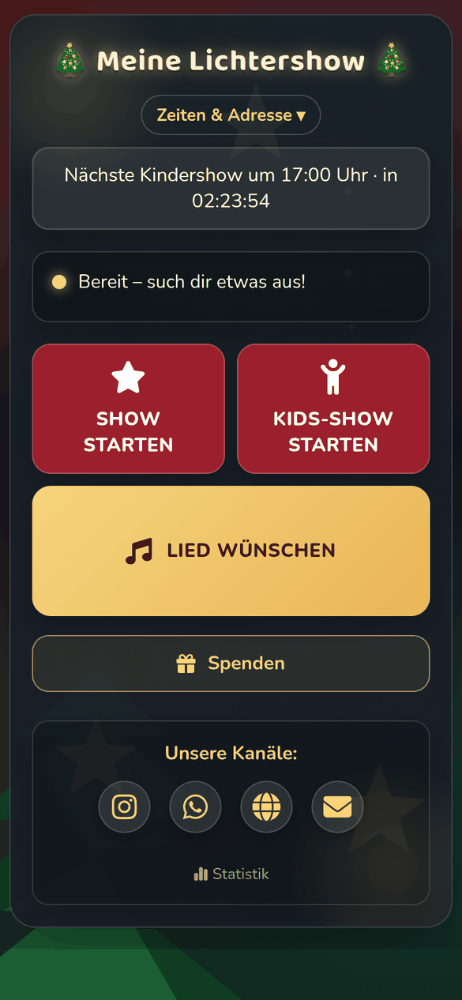
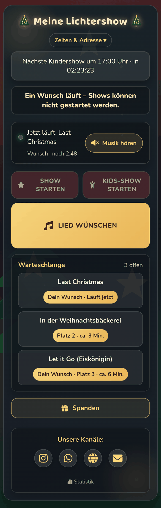
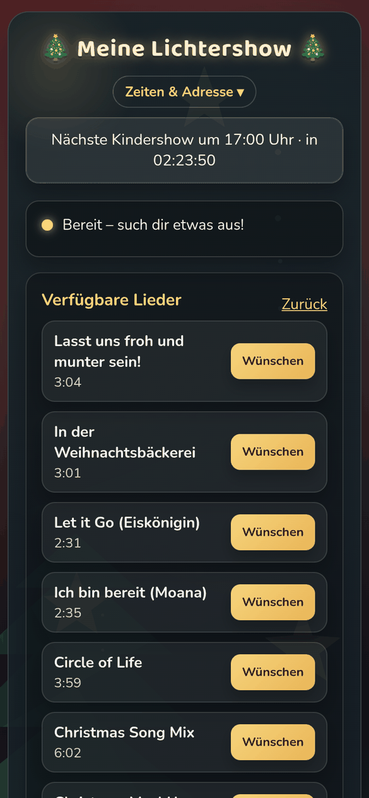
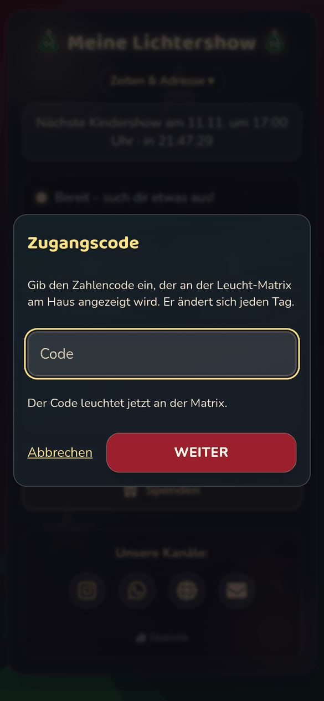
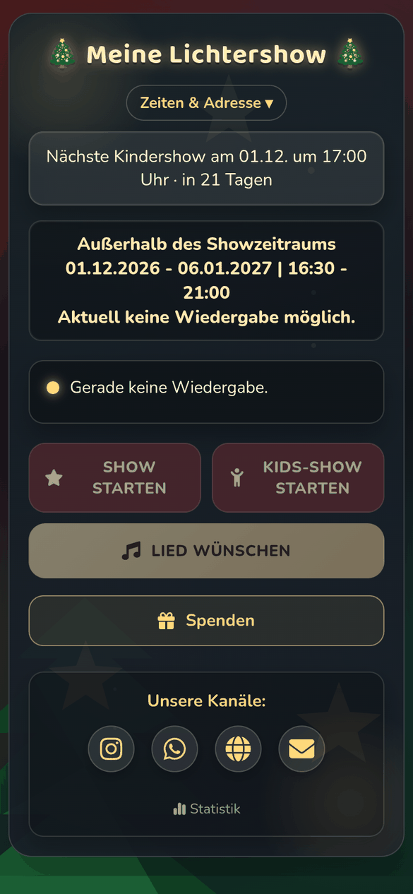
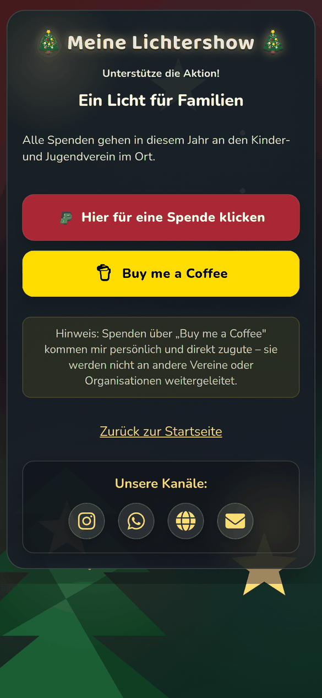
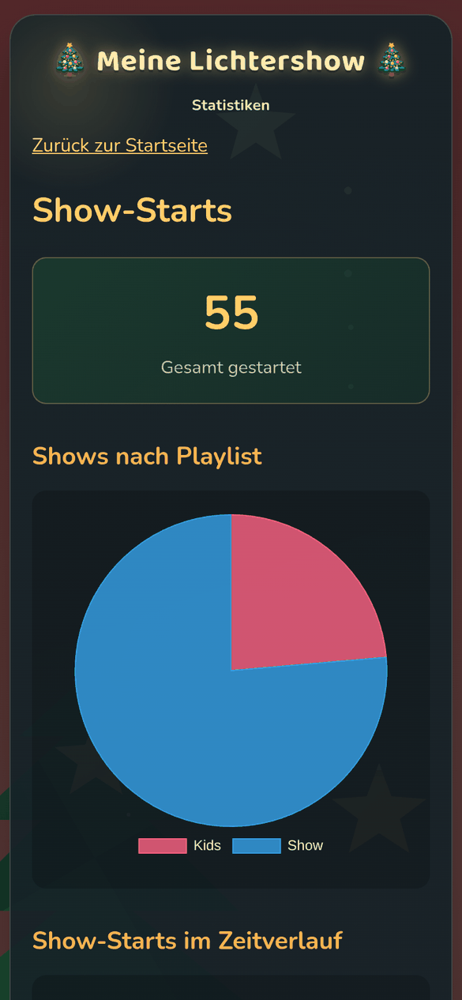

# 🎄 FPP Web Control

[Deutsch](README.de.md) · **English**

**Web control for the Falcon Player (FPP) – for interactive Christmas and holiday light shows**

Visitors use their phones to start shows, request songs, listen to the music in sync on their own device and donate. They only ever talk to this web app, never directly to the Falcon Player.

[](https://www.docker.com/)
[](https://www.python.org/)
[](https://flask.palletsprojects.com/)

---

## 📖 Contents

- [Features](#-features)
- [Screenshots](#-screenshots)
- [Quick start](#-quick-start)
- [Configuration](#-configuration)
- [Languages](#-languages)
- [Access protection](#-access-protection)
- [Manual mode](#-manual-mode)
- [Music on the visitor's device (FalconBeat)](#-music-on-the-visitors-device-falconbeat)
- [Notifications](#-notifications)
- [Deployment](#-deployment)
- [API](#-api)
- [Development](#-development)
- [FAQ](#-faq)
- [License](#-license)

More documents: [Reaching the app from the internet](docs/internet-access.md), [deploy/README.md](deploy/README.md) (reverse proxy and FalconBeat), [NOTIFICATIONS.md](NOTIFICATIONS.md) (notifications), [ARCHITECTURE.md](ARCHITECTURE.md) (internals, German), [CHANGELOG.md](CHANGELOG.md) (German).

---

## ✨ Features

### For visitors

- **Start shows**: as many show buttons as you like, each starting one FPP playlist (e.g. main show, kids' show, a retro show)
- **Request songs**: a list taken from an FPP playlist, a queue with position and estimated wait, the visitor's own requests are marked
- **"Now playing"**: title and time left of the current song at the top of the page
- **Music on their own device**: one button plays the music in the browser, in sync with the light show (needs [FalconBeat](#-music-on-the-visitors-device-falconbeat))
- **Countdown** to the next scheduled show with its type and time
- **Donations**: PayPal pool and optionally "Buy me a Coffee"
- **Made for phones**: large touch targets, festive design, support for screen readers and "reduce motion"
- **Multilingual**: English and German, following the browser language, with a switch; more languages can be added

### For operators

- **Time control**: season (dates) and daily show times; outside them the buttons are locked
- **Schedule**: automatic shows at times of your choice
- **Background effect**: runs automatically while nothing else plays; outside show times it is left alone (e.g. as ordinary Christmas lights until late at night)
- **Volume**: optionally the app sets the FPP volume for shows and requests, in as many time periods as you like, and turns it back afterwards
- **Manual mode**: switch the app off for events you run by hand – from FPP (scheduler, playlist) or a bookmark – and back on afterwards
- **Access protection**: a fixed code, or a code that changes daily and is shown on a pixel matrix at the house
- **Fair requests**: limits per device and for the whole queue
- **Statistics**: show starts and song requests with charts, per calendar year; past years in an archive
- **Notifications**: MQTT, ntfy, Home Assistant, webhook
- **Privacy-friendly**: fonts, icons and libraries are served by the app itself; visitors never connect to Google Fonts or CDNs
- **Docker secrets**: every setting can be read from a file

---

## 📸 Screenshots

Taken at phone width with sample data (German interface).

| Start page | During a requested song | Song list |
|---|---|---|
|  |  |  |
| Countdown to the next show, clear order of the buttons | Title and time left, "Listen", own requests with position and wait | Titles from the note of the FPP playlist |

| Daily code on the matrix | Outside show times | Donations | Statistics |
|---|---|---|---|
|  |  |  |  |

---

## 🚀 Quick start

### Requirements

- Docker and Docker Compose
- A Falcon Player (FPP) that the Docker host can reach
- Playlists on the FPP (show, optionally a kids' show, a request list)

### Installation

```bash
git clone https://github.com/TimUx/fpp-web-control.git
cd fpp-web-control
cp .env.example .env
```

Adjust at least these values in `.env`:

```bash
SITE_NAME="🎄 My Light Show 🎄"
FPP_BASE_URL=http://192.168.1.100
FPP_SHOWS="Show=Start the show|Kids=Kids' show"
FPP_PLAYLIST_REQUESTS=wishlist
FPP_SHOW_START_DATE=2026-12-01
FPP_SHOW_END_DATE=2027-01-06
FPP_SHOW_START_TIME=16:30
FPP_SHOW_END_TIME=21:00
ACCESS_CODE=
```

Then start it and open `http://localhost:8080` in the browser:

```bash
docker compose up -d
```

Without `.env` and without `config.json` the container starts with default values. For Docker Swarm see [Deployment](#-deployment).

### Song titles in the request list

The title shown is the **note** of the entry in the FPP playlist editor. Without a note the sequence name without its file extension is used.

---

## 🔧 Configuration

Every setting can be given in three ways. If a setting is given more than once, the one higher up wins:

1. **`config/config.json`** (key in the "config.json" column)
2. **A file via `<VARIABLE>_FILE`**, e.g. `ACCESS_CODE_FILE=/run/secrets/fpp_access_code` (Docker secrets)
3. **Environment variable** ("Variable" column)

The included `docker-compose.yml` loads the `.env` file; in `docker-stack.yml` the variables are written directly into the file (see [Deployment](#-deployment)).

Changes take effect after the container restarts. Complete examples: [`config/config.example.json`](config/config.example.json) and [`.env.example`](.env.example) (comments in German).

### Page

| Variable | config.json | Description | Default |
|---|---|---|---|
| `SITE_NAME` | `siteName` | Name of the show (heading, tab title) | "FPP Light Show" in the visitor's language |
| `SITE_SUBTITLE` | `siteSubtitle` | Times and address; line breaks with `\n`. Open outside show times, collapsed during show times | "Remote control for the Falcon Player" |
| `SITE_DESCRIPTION` | `siteDescription` | Short text for search engines and link previews | default text in the visitor's language |
| `SITE_IMAGE_URL` | `siteImageUrl` | Full URL of a preview image for shared links | empty |
| `APP_LANGUAGE` | `language` | Language of the pages: `auto` = the visitor's browser language with a switch, or fixed `en`, `de` | `auto` |
| `APP_DEFAULT_LANGUAGE` | `defaultLanguage` | Language when there is no translation for the browser language, and for notifications | `en` |
| `PREVIEW_MODE` | `previewMode` | Preview without FPP, with sample data | `false` |

### FPP and playlists

| Variable | config.json | Description | Default |
|---|---|---|---|
| `FPP_BASE_URL` | `fppBaseUrl` | Address of the FPP | `http://fpp.local` |
| `FPP_SHOWS` | `shows` | The show buttons, see below | the two classic buttons |
| `FPP_PLAYLIST_1`, `FPP_PLAYLIST_2` | `playlist1`, `playlist2` | Only without `FPP_SHOWS`: playlists of the two classic buttons | `show 1`, `show 2` |
| `BUTTON_PLAYLIST_1`, `BUTTON_PLAYLIST_2` | `buttonPlaylist1Text`, `buttonPlaylist2Text` | Only without `FPP_SHOWS`: their labels | "Start playlist 1", "Start playlist 2" |
| `FPP_PLAYLIST_REQUESTS` | `playlistRequests` | Playlist with the songs visitors can request | `all songs` |
| `FPP_BACKGROUND_EFFECT` | `backgroundEffect` | FPP effect that runs while idle (empty = none), see below | `background` |
| `FPP_SHOW_VOLUME` | `showVolume` | FPP volume during shows and requests: one number (`80`) or any number of periods (`16:00-18:00=90,18:00-20:00=75,20:00-21:00=50`); empty = the app doesn't touch the volume | empty |
| `FPP_IDLE_VOLUME` | `idleVolume` | Volume once everything is over and the background runs again (e.g. `0`); empty = don't change | empty |
| `FPP_POLL_INTERVAL_MS` | `fppPollIntervalMs` | How often the FPP is polled while idle; while something plays, every 5 s | `15000` |
| `CLIENT_STATUS_POLL_MS` | `clientStatusPollMs` | How often the browser polls while idle; while something plays, every 4 s | `10000` |

### Show times

| Variable | config.json | Description | Default |
|---|---|---|---|
| `FPP_SHOW_START_DATE` | `showStartDate` | First day of the season (`YYYY-MM-DD`) | empty (no limit) |
| `FPP_SHOW_END_DATE` | `showEndDate` | Last day of the season | empty (no limit) |
| `FPP_SHOW_START_TIME` | `showStartTime` | Daily start time (`HH:MM`, 24 h) | `16:30` |
| `FPP_SHOW_END_TIME` | `showEndTime` | Daily end time; quiet hours afterwards | `22:00` |
| `FPP_SHOW_END_CHECK` | `showEndCheck` | Don't start anything that would run past the end of the show time (see below) | `true` |
| `FPP_SHOW_END_TOLERANCE_MINUTES` | `showEndToleranceMinutes` | Tolerance in minutes by which the end may be exceeded | `5` |
| `SCHEDULED_SHOWS_ENABLED` | `scheduledShowsEnabled` | Automatic shows from the schedule | `true` |
| `FPP_SHOW_SCHEDULE` | `showSchedule` | Schedule, see below | 17:00 playlist 2, 18:00–21:00 hourly playlist 1 |

**End of the show time:** Before a show starts or a request is added to the queue, the app works out when everything would be over: what is playing now (for a show the rest of the current song plus all following songs of the playlist), all waiting requests with their lead-in, and the new item. If that would be later than `FPP_SHOW_END_TIME` plus the tolerance, it is refused, and the visitor sees when it would end. Example with show time until 9:00 PM and a 5-minute tolerance: a 17-minute kids' show can no longer start at 8:56 PM, a 6-minute song at 8:59 PM still can (ends 9:05 PM). In the request list, songs that no longer fit are shown as "Too long for today". The lengths come from the FPP playlists; if one is unknown, the app lets the start through. Scheduled shows from the schedule are not checked.

**Background effect:** The app stops it before every show and request. During show times it makes sure it runs as soon as nothing else plays; it asks FPP whether it really runs and restarts it, e.g. after FPP was restarted. Outside show times it leaves it alone: it neither switches it off nor on. Only if the app itself stopped it for a show or request that ran past the end of the show times does it start it again afterwards. That way FPP can keep running as ordinary Christmas lights after the show times; switch it on and off with the FPP scheduler.

**Volume:** With `FPP_SHOW_VOLUME` the app sets the volume for shows and requests. Write periods as `FROM-TO=PERCENT`, separated by commas, as many as you like, e.g. `16:00-18:00=90,18:00-20:00=75,20:00-21:00=50` (`16-18=90` works too, and a period may cross midnight). What counts is when a song starts: a song that is playing never gets quieter, the next period applies from the next song on. If a song starts outside all periods, the app leaves the volume as it is. `config.json` also takes a list: `[{"from": "16:00", "to": "18:00", "volume": 90}]`. A show started directly on the FPP gets this volume too. With `FPP_IDLE_VOLUME` the volume goes back once everything is over. The app uses FPP's *Volume Set* command, which doesn't rewrite FPP's settings file on every change; after losing the connection to FPP it sets the volume again. This does not affect the volume on visitors' phones (FalconBeat). Remove volume entries from the FPP scheduler when you use this, or the two will keep changing each other's setting.

**Show buttons:** Every entry of `FPP_SHOWS` becomes one button on the start page, in that order, two per row and all the same size; with an odd number the last one is centred. Under the label each button shows the playing time of its playlist (e.g. "22 min"), read from FPP; FPP fills in the lengths itself for entries with a sequence or media file. Short form: `PLAYLIST=LABEL`, entries separated by `|`, e.g. `FPP_SHOWS="Show=Start the show|Kids=Kids' show|Retro"` (without a label the button reads "Start Retro"). For an icon and a short name use JSON – in `config.json` as a list, or as a JSON string in the variable:

```json
"shows": [
  { "playlist": "Show", "label": "Start the show" },
  { "playlist": "Kids", "label": "Kids' show", "name": "kids' show", "icon": "child-reaching" },
  { "playlist": "Retro", "label": "80s show", "icon": "music", "special": true }
]
```

| Field | Meaning |
|---|---|
| `playlist` | Name of the FPP playlist (required) |
| `label` | Text on the button; default "Start <playlist>" in the visitor's language |
| `name` | Short name for the countdown ("Next kids' show"); without it the countdown says "Next show" for the first button and the playlist name in quotes for the others |
| `icon` | Symbol from the list below; default `star` (second button `child-reaching`) |
| `special` | `true` for a special show next to the main shows (e.g. by genre or with songs from past years): same size, quieter colour |

**Symbols for show buttons:**

| Theme | Symbols |
|---|---|
| Christmas | `tree`, `snowflake`, `bell`, `sleigh`, `candy-cane`, `gift`, `gifts`, `snowman`, `holly-berry`, `star` |
| Kids | `child-reaching`, `snowman`, `candy-cane` |
| Music | `music`, `guitar` (rock), `drum`, `microphone`, `microphone-lines` (pop), `record-vinyl` (hip-hop), `headphones`, `sliders`, `bolt` (EDM), `compact-disc`, `radio`, `violin`, `piano` (classical), `feather` |
| Other | `masks-theater`, `crown`, `fire`, `heart`, `champagne-glasses` (New Year's Eve), `wand-magic-sparkles`, `play`, `clock` |

They come from Font Awesome Free 6.5.1 (CC BY 4.0); `violin` and `piano` are drawn for this project, because Font Awesome Free has neither.

The buttons are numbered `playlist1`, `playlist2`, … in that order; these names work in the schedule and in the API. Without `FPP_SHOWS` the app shows the two classic buttons from `FPP_PLAYLIST_1`/`_2` and `BUTTON_PLAYLIST_1`/`_2`, as before.

**Schedule:** `TIME=PLAYLIST`, separated by commas. As playlist use a button name (`playlist1`, `playlist2`, …) or the name of an FPP playlist. Example: `17:00=playlist2,19:00=playlist1`. Shows that fall into quiet hours are skipped. `config.json` also takes a list: `[{"time": "17:00", "playlist": "playlist2"}]`.

### Requests and statistics

| Variable | config.json | Description | Default |
|---|---|---|---|
| `MAX_WISHES_PER_DEVICE` | `maxWishesPerDevice` | Open requests per device, `0` = unlimited | `2` |
| `MAX_QUEUE_LENGTH` | `maxQueueLength` | Length of the queue, `0` = unlimited | `10` |
| `FPP_WISH_LEAD_IN_SEQUENCE` | `wishLeadInSequence` | Short sequence played before every requested song (lead-in, see below) | empty |
| `FPP_WISH_LEAD_IN_MEDIA` | `wishLeadInMedia` | Audio file for the lead-in sequence, e.g. `request-intro.mp3` | empty (no music) |
| `FPP_WISH_LEAD_IN_SECONDS` | `wishLeadInSeconds` | Pause in seconds before every requested song if no lead-in sequence is set (at most 60), `0` = off | `0` |
| `FPP_WISH_TITLE_ON_MATRIX` | `wishTitleOnMatrix` | Scroll the title of the request across the matrix during the lead-in | `false` |
| `FPP_WISH_TITLE_COLOR` | `wishTitleColor` | Colour of the scrolling text (`#RRGGBB`) | like `CODE_MATRIX_COLOR` |
| `FPP_WISH_TITLE_RENDERER` | `wishTitleRenderer` | `fpp` = FPP draws the scrolling text itself (smooth); `app` = the app sends every frame (older FPP) | `fpp` |
| `FPP_WISH_TITLE_FONT` | `wishTitleFont` | Font for `fpp`, one of FPP's font list | `FreeSansBold` |
| `STATISTICS_RETENTION_DAYS` | `statisticsRetentionDays` | Delete statistics entries after N days, `0` = never | `0` |

**Lead-in before requests:** With [FalconBeat](#-music-on-the-visitors-device-falconbeat) a requested song is only uploaded to the server when it starts, and the phones download it after that. Without a lead-in the music on the phones starts a few seconds after the lights. A lead-in of about 5 seconds bridges that: either a short sequence of your own without music (e.g. a countdown on the matrix, name of the `.fseq` file) or a plain pause with the lights dark. The lead-in only plays before requests that have an audio file. Without FalconBeat you don't need it.

The lead-in sequence can have music of its own (`FPP_WISH_LEAD_IN_MEDIA`). Keep the audio file as short as the sequence, because it is uploaded with every request. On the phones the music of the lead-in starts late; the requested song after it starts on time.

**Title on the matrix:** With `FPP_WISH_TITLE_ON_MATRIX=true` the title of the request scrolls across the matrix during the lead-in. It uses the matrix of the [daily code](#daily-code-on-the-pixel-matrix) (`CODE_MATRIX_MODEL` and the wiring values) By default FPP draws the scrolling text itself (overlay effect *Text*, font size fitted to the matrix height): the app sends a single command and the text moves evenly pixel by pixel, whatever the network does. If FPP doesn't know the effect, the app draws it frame by frame in capital letters as before. The text covers the sequence and frees the matrix shortly before the song. The app reads the length of the lead-in sequence from FPP; if that fails, `FPP_WISH_LEAD_IN_SECONDS` applies (otherwise 8 seconds). Test it first:

```bash
python code_matrix.py --fpp http://192.168.1.100 --model Matrix --scroll --text "Last Christmas" \
    --strands-per-string 12 --orientation V --seconds 10
```

At the end the output names the frames per second reached. From about 10 the text scrolls smoothly; below that the connection to the FPP is too slow.

### Donations and channels

| Variable | config.json | Description |
|---|---|---|
| `DONATION_POOL_ID` | `donationPoolId` | ID of the PayPal pool |
| `DONATION_CAMPAIGN_NAME` | `donationCampaignName` | Name of the fundraiser |
| `DONATION_SUBTITLE` | `donationSubtitle` | Subtitle of the donation page |
| `DONATION_TEXT` | `donationText` | Description |
| `BUYMEACOFFEE_USERNAME` | `buyMeACoffeeUsername` | User name at "Buy me a Coffee" |
| `SOCIAL_FACEBOOK`, `SOCIAL_INSTAGRAM`, `SOCIAL_TIKTOK`, `SOCIAL_WHATSAPP`, `SOCIAL_YOUTUBE`, `SOCIAL_WEBSITE` | `socialFacebook` … `socialWebsite` | Links in the footer (`http`/`https` only) |
| `SOCIAL_EMAIL` | `socialEmail` | Email address in the footer |

The settings for access protection, FalconBeat and notifications are in the following sections.

---

## 🌍 Languages

The interface is available in **English** and **German**. With `APP_LANGUAGE=auto` (the default) every visitor gets the language of their browser; at the bottom of the page they can switch, and the browser remembers the choice for a year. For browser languages without a translation `APP_DEFAULT_LANGUAGE` applies. With `APP_LANGUAGE=en` (or `de`) the language is fixed and the switch is not shown.

All texts of the app itself are translated, including messages from the server. Your own texts (show name, subtitle, button labels, donation texts) appear exactly as you enter them. If you leave them empty, the default text appears in the visitor's language. Notifications to you (ntfy, MQTT …) use `APP_DEFAULT_LANGUAGE`, or the fixed language.

**Adding a language:** copy `i18n/en.json` to `i18n/<code>.json` (e.g. `fr.json`), translate the values and rebuild the container. The language then shows up in the switch automatically. Missing entries are shown in English. Pull requests with new languages are very welcome.

---

## 🔐 Access protection

Without access protection, anybody who knows the address can start shows. There are two methods, and they can be combined. With both, everybody sees the page with all its buttons; the code is asked for in a dialog only at the first action. The code is always checked by the server and never appears in the page source. After 6 wrong attempts a connection has to wait 10 minutes.

### Fixed code

| Variable | config.json | Description |
|---|---|---|
| `ACCESS_CODE` | `accessCode` | Fixed access code (empty = off) |

### Daily code on the pixel matrix

A pixel matrix at the house shows a number that changes every day. Only people standing in front of the house can read it, and there is never a sign to update.

- During show times the code appears whenever nothing is playing, also briefly between two requested songs. When something starts, it disappears first. Songs that are playing are not disturbed.
- The page and all buttons are visible without the code. The code is asked for only when someone wants to start a show or request a song; then the action continues.
- Visitors type it in once and stay unlocked until midnight.
- The matrix must exist in FPP as a **pixel overlay model**.

| Variable | config.json | Description | Default |
|---|---|---|---|
| `CODE_MATRIX_MODEL` | `codeMatrixModel` | Name of the overlay model in FPP (empty = off) | empty |
| `CODE_MATRIX_DIGITS` | `codeMatrixDigits` | Number of digits (2–6) | `3` |
| `CODE_MATRIX_COLOR` | `codeMatrixColor` | Colour of the digits (`#RRGGBB`) | `#FFFFFF` |
| `CODE_MATRIX_STRINGS` | `codeMatrixStrings` | Number of strings of the matrix | from FPP |
| `CODE_MATRIX_STRANDS_PER_STRING` | `codeMatrixStrandsPerString` | Strands per string | from FPP |
| `CODE_MATRIX_ORIENTATION` | `codeMatrixOrientation` | `V` (vertical strands) or `H` | from FPP |
| `CODE_MATRIX_START_CORNER` | `codeMatrixStartCorner` | `TL`, `TR`, `BL` or `BR` | from FPP |
| `CODE_SECRET` | `codeSecret` | Secret the code is calculated from | generated and stored in `data/code_secret` |
| `ACCESS_HINT` | `accessHint` | Your own hint above the input field | default text |

**Wiring:** The four wiring values are only needed if FPP describes the model differently from how the matrix is built. xLights, for example, likes to upload a matrix of 3 strings with 12 vertical strands each as "300 × 3". That's why the app draws the digits itself (5×7 grid, as large as possible). A matrix of 36 × 25 pixels shows three digits clearly.

**Test it first:** The tool shows a number for a few seconds and frees the matrix again afterwards. With `--dry-run` it only prints a text picture and doesn't switch any lights.

```bash
python code_matrix.py --fpp http://192.168.1.100 --model Matrix --text 123 \
    --strands-per-string 12 --orientation V --seconds 20
```

If the number is mirrored or upside down, adjust the start corner or the orientation.

---

## 🎛️ Manual mode

For events where you run FPP by hand, switch the app off: it then leaves FPP alone until you switch it back on. While it is off the app

- starts no shows and no song requests; the buttons are locked and the page says the show is being run by hand,
- drops the waiting requests and skips scheduled shows (they don't start late afterwards),
- doesn't touch the background effect or the volume, and shows no access code on the matrix,
- keeps showing what is playing, and FalconBeat keeps working.

Once you switch it back on, everything runs as usual: when nothing is playing, the app starts the background effect (within show times) and sets the volume again. The switch survives a restart of the app. Notifications report each change.

Set a long random token:

```bash
CONTROL_TOKEN=a-long-random-secret   # e.g. from: openssl rand -hex 16
```

Then call one of these addresses (without `CONTROL_TOKEN` they answer 404):

| Address | Effect |
|---|---|
| `/api/control/off?token=…` | Manual mode on (the app keeps out) |
| `/api/control/on?token=…` | The app takes over again |
| `/api/control?token=…` | Only shows the current state |

The token can also be sent as `Authorization: Bearer …` or `X-Control-Token`; `POST /api/control` with `{"enabled": false}` works too. Wrong tokens count as failed attempts like a wrong access code.

**From FPP itself:** FPP can call such an address with its *URL* command.

1. In FPP under *Content Setup → Command Presets* add two presets, e.g. `WebControl off` and `WebControl on`, each with the command **URL**, method **GET** and the address, e.g. `https://lights.example.com/api/control/off?token=…`. FPP has to reach the app at that address.
2. Use them where it fits:
   - **Scheduler:** for a planned event add a scheduler entry of type *Command* with the command **Trigger Command Preset** running `WebControl off` before it and one running `WebControl on` afterwards.
   - **Playlist:** a *Command* entry (**Trigger Command Preset**) at the start of your event playlist (and `WebControl on` at its end).
   - **By hand:** a playlist that contains only the command, e.g. `WebControl off`; start it on the FPP status page when needed.

**From the phone:** save the addresses as bookmarks. Keep them to yourself: whoever knows the token can switch the app off.

### 🧪 Test mode

With the same token you can switch on a test mode: the show buttons and song wishes then also work outside the show times (quiet hours and outside the show period), so you can try them out live. The access code also appears on the matrix. The page shows a "Test mode until …" notice.

| Address | Effect |
|---|---|
| `/api/control/test/on?token=…` | Test mode on (for `TEST_MODE_MINUTES`, default 60 minutes; calling it again extends it) |
| `/api/control/test/on?token=…&minutes=120` | Test mode for a duration of your choice (1–720 minutes) |
| `/api/control/test/off?token=…` | Test mode off |

- It switches itself off when the time is up, also across a restart of the app.
- Everything else stays as usual: lock while a show runs, wish limits, access code and scheduled shows. The show-end check only applies within the show times.
- Shows and wishes that were only possible because of test mode are kept out of the statistics. Notifications are sent, so you can test those too.
- If test mode ends outside the show times, the app drops wishes still waiting; whatever plays now runs to its end.
- Manual mode wins: while it is on, everything stays locked.

In FPP you can set up test mode as Command Presets just like manual mode (e.g. `WebControl test on` / `WebControl test off`). Don't paste them into chats, since link previews open the address.

---

## 🔊 Music on the visitor's device (FalconBeat)

If the plugin [fpp-plugin-FalconBeat](https://github.com/GraphicHealer/fpp-plugin-FalconBeat) is installed and enabled on the FPP and a [FalconBeat server](https://github.com/GraphicHealer/FalconBeat) is running, a "Listen" button appears while a show plays. One tap plays the music in the browser, in sync with the light show. Nobody has to open the separate FalconBeat page.

| Variable | config.json | Description | Default |
|---|---|---|---|
| `FALCONBEAT_MODE` | `falconbeatMode` | `auto` = offer it when the plugin is enabled; `on` = skip the plugin check; `off` = off | `auto` |
| `FALCONBEAT_SERVER_URL` | `falconbeatServerUrl` | Server as seen from the container, only for the health check | address from the plugin |
| `FALCONBEAT_CLIENT_BASE` | `falconbeatClientBase` | Path under which the browser reaches the server | `/falconbeat` |

**Requirement:** The reverse proxy must pass `/falconbeat/ws` and `/falconbeat/media/*` on to the FalconBeat server. Instructions and Traefik templates: [deploy/README.md](deploy/README.md).

Good to know:

- Browsers only allow sound after a tap. After reloading the page the button has to be tapped again.
- If nothing plays for 5 minutes, the music disconnects by itself so the screen doesn't stay on forever.
- Going to the donation or statistics page stops the music. That's why the request list is part of the start page.

---

## 🔔 Notifications

On show starts and song requests the app can send notifications: via **ntfy**, **MQTT**, **Home Assistant** or a **webhook**. The quickest way to start is ntfy:

```json
{
  "notifyEnabled": true,
  "notifyNtfyEnabled": true,
  "notifyNtfyTopic": "my-show-xyz123"
}
```

All settings (`NOTIFY_*`) and guides are in [NOTIFICATIONS.md](NOTIFICATIONS.md). In preview mode no notifications are sent.

---

## 📦 Deployment

There are two ready-made files:

| File | For | Settings |
|---|---|---|
| [`docker-compose.yml`](docker-compose.yml) | Docker Compose on a single host | from the `.env` file |
| [`docker-stack.yml`](docker-stack.yml) | Docker Swarm (`docker stack deploy`) | directly in the file under `environment`, secrets as Docker secrets |

In both cases you can also mount `config/config.json`. Values there take precedence.

### Docker Compose

```bash
cp .env.example .env                 # adjust the values
docker compose up -d                 # start (pulls the ready-made image)
docker compose up -d --build         # build locally instead
docker compose pull && docker compose up -d   # update
```

- `.env` is loaded into the container via `env_file`. If the file is missing, the container starts with default values (needs Docker Compose 2.24 or newer).
- Put values with `#` or spaces in quotes, e.g. `CODE_MATRIX_COLOR="#FFFFFF"`. Inside double quotes `\n` becomes a line break.
- Mounted are `./config` → `/app/config` (optional) and `./data` → `/app/data` (statistics, secret for the daily code).

### Docker Swarm

```bash
printf 'my-code' | docker secret create fpp_access_code -
docker stack deploy -c docker-stack.yml fpp-control
```

- `docker stack deploy` doesn't load a `.env` into the container. All settings are therefore in `docker-stack.yml` under `environment`.
- Secret values come as Docker secrets via `<VARIABLE>_FILE`. The file shows this for the access code, the PayPal pool and the ntfy token. Remove secrets you don't need in both places, or the stack won't start.
- Adjust before the first start: volume paths, placement (`node.hostname`), domain and network in the Traefik labels.
- Don't change `replicas: 1` and `update_config.order: stop-first`, see the next section.

Ready-made images are at `ghcr.io/timux/fpp-web-control`.

### Important: one worker only

Queue, schedule and status live in the memory of the process. The app must therefore run with **one** Gunicorn worker (threads are fine):

```bash
gunicorn --workers 1 --threads 8 -b 0.0.0.0:8000 app:app
```

Several workers or several container replicas would multiply the queue and the schedule. The Dockerfile already starts it this way.

### Reverse proxy and HTTPS

How to make the app reachable from the internet safely (own domain, dynamic DNS, port forwarding, reverse proxy, Cloudflare Tunnel, Tailscale) is described in detail in [Reaching the app from the internet](docs/internet-access.md).

For use on the internet, put a reverse proxy with HTTPS in front of it (Traefik, Caddy, nginx). Keep in mind:

- **`X-Forwarded-For`** must be set by the proxy. The lock after wrong codes counts per address and takes the last entry of this header.
- **Rate limit**: be generous. During a show every visitor polls the status about every 4 seconds, and on mobile networks many visitors share one address.
- **Compression**: switch it on in the proxy.
- **FalconBeat paths**: pass them on if you use it.

Templates for Traefik are in [deploy/](deploy/README.md). Minimal example for Caddy:

```caddyfile
lightshow.example.com {
    encode gzip
    reverse_proxy localhost:8080
}
```

### Without Docker

```bash
python3 -m venv venv && source venv/bin/activate
pip install -r requirements.txt
mkdir -p config data && cp config/config.example.json config/config.json
APP_CONFIG_PATH=config/config.json sh docker-entrypoint.sh \
    gunicorn --workers 1 --threads 8 -b 0.0.0.0:8000 app:app
```

`docker-entrypoint.sh` creates `config.js` for the browser and then runs the given command.

---

## 🔌 API

The interface uses these endpoints. With access protection enabled, writing calls need the `X-Access-Code` header.

| Method | Path | Purpose |
|---|---|---|
| `GET` | `/api/state` | State for the interface |
| `POST` | `/api/access` | Check the access code |
| `POST` | `/api/show` | Start a show |
| `GET` | `/api/requests/songs` | Songs that can be requested |
| `POST` | `/api/requests` | Request a song |
| `GET` | `/api/statistics` | Statistics of a year (`?year=YYYY`, default: current year) |
| `GET` | `/health` | Sign of life (`{"status": "ok"}`) |

Texts in responses (`message`, `locks.reason`, `note`, `siteName`) come in the language of the request: the `fpp-lang` cookie, otherwise the `Accept-Language` header.

### `GET /api/state`

The optional `X-Device-Id` header (an anonymous ID of the browser) marks the visitor's own requests as `mine`.

```json
{
  "siteName": "🎄 My Light Show 🎄",
  "status": {
    "is_running": true, "is_idle": false,
    "playlist_name": "__wish_single__", "playlist_label": "__wish_single__",
    "current_sequence": "Last Christmas.fseq", "seconds_remaining": 183, "mode_name": "player"
  },
  "fppReachable": true,
  "nowPlaying": { "title": "Last Christmas", "kind": "wish", "secondsRemaining": 181 },
  "currentRequest": { "title": "Last Christmas", "duration": 262, "mine": true },
  "queue": [
    { "title": "Last Christmas", "duration": 262, "mine": true, "waitSeconds": 0 },
    { "title": "Feliz Navidad", "duration": 183, "mine": false, "waitSeconds": 181 }
  ],
  "limits": { "maxWishesPerDevice": 2, "maxQueueLength": 10 },
  "locks": {
    "disableAllButtons": false, "disableShowButtons": true,
    "quiet": false, "outsideShowWindow": false,
    "reason": "A request is playing – shows can't be started.",
    "showPeriod": { "startDate": "12/1/2026", "endDate": "1/6/2027", "startTime": "4:30 PM", "endTime": "9:00 PM" }
  },
  "nextShow": { "time": "2026-12-01T17:00:00+01:00", "playlist": "Kids", "label": "Kids", "kind": "playlist2" },
  "scheduledShowActive": false,
  "scheduledShowsEnabled": true,
  "falconbeat": { "available": true },
  "accessCode": { "onMatrix": true, "visible": false },
  "note": ""
}
```

`nowPlaying.kind` is `show` or `wish` (a request). `waitSeconds` is `null` while a main show plays, because its remaining length isn't known.

### `POST /api/access`

```json
{ "accessCode": "735" }
```

Response `200 {"ok": true}`, `403` for a wrong code, `429` with `retryAfter` (seconds) after too many failed attempts.

### `POST /api/show`

```json
{ "type": "playlist1" }
```

`type` is the button name `playlist1`, `playlist2`, … (in the order of `FPP_SHOWS`). Response: `{"ok": true, "message": "Show started."}`.

### `GET|POST /api/control`, `/api/control/off`, `/api/control/on`, `/api/control/test/on|off`

Manual mode, see [Manual mode](#-manual-mode). Needs `CONTROL_TOKEN`. Response: `{"ok": true, "enabled": false, "manualMode": true, "since": "2026-12-12T18:00:00+01:00", "changed": true}`. Responses also carry `testMode` and `testUntil`; `POST /api/control` takes `{"test": true, "minutes": 90}` as well. `GET /api/state` also has `manualMode`, `testMode` (`{"active", "until", "untilTime"}`), `locks.manual` and `locks.test`, and `showDurations` (playing time per button in seconds, e.g. `{"playlist1": 1326}`).

### `GET /api/requests/songs`

```json
{ "songs": [ { "title": "Last Christmas", "duration": 262, "sequenceName": "Last Christmas.fseq", "mediaName": "Last Christmas.mp3", "wishes": 12 } ] }
```

`wishes` = how often the song was wished so far according to the statistics (for the "Popular" sort).

### `POST /api/requests`

```json
{ "song": "Last Christmas" }
```

Only the title counts. It must be in the request playlist; the server finds the sequence and audio file itself. Response: `{"ok": true, "position": 2, "message": "…"}`.

### Status codes

| Code | Meaning |
|---|---|
| `200` | Success |
| `400` | Invalid request, e.g. the song isn't on the request list |
| `403` | Access code missing or wrong |
| `409` | Not possible: already requested, queue full, per-device limit reached, buttons locked |
| `429` | Too many wrong codes |
| `502` | FPP not reachable or start failed |

---

## 🧰 Development

### Project structure

```
fpp-web-control/
├── app.py                  # Backend: API, FPP connection, queue, schedule, daily code
├── code_matrix.py          # Draws digits/text on an FPP overlay model (also a test tool)
├── i18n.py, i18n/          # Translations (en.json, de.json …) for server and browser
├── index.html              # Start page with the request list
├── donation.html           # Donation page
├── statistics.html         # Statistics page
├── styles.css              # Whole design
├── app.js                  # Shared helpers: access, toasts, icons, footer, translations
├── falconbeat-audio.js     # Sync client for the music in the browser
├── static/
│   ├── js/                 # Scripts of the three pages
│   ├── fonts/              # Fonts (Baloo 2, Nunito)
│   ├── vendor/             # Chart.js
│   ├── icons.svg           # Icons
│   └── LICENSES.md         # Licenses of the bundled files
├── deploy/                 # Reverse proxy guide and Traefik templates
├── docs/                   # Guides (internet access) and screenshots
├── config/config.example.json
├── docker-entrypoint.sh    # Creates config.js at start
├── Dockerfile, requirements.txt
├── docker-compose.yml      # Docker Compose, settings from .env
├── docker-stack.yml        # Docker Swarm, settings in the file
└── README.md, README.de.md, NOTIFICATIONS(.de).md, ARCHITECTURE.md, CONTRIBUTING.md, CHANGELOG.md
```

### Running locally

With `PREVIEW_MODE=true` (or `"previewMode": true` in `config/config.json`) the interface runs without FPP, with sample data. Start it as shown under [Without Docker](#without-docker).

### Notes for changes

- **No inline scripts:** the Content Security Policy only allows scripts from the app's own files. New code goes into `static/js/` or `app.js`.
- **Nothing from third-party servers:** fonts, icons and libraries live in `static/`. New icons go into `static/icons.svg`.
- **Never insert visitor input as HTML:** always use `textContent`.
- **No hard-coded texts:** add new texts as keys to `i18n/en.json` **and** `i18n/de.json`. In HTML use `{{t:key}}`, in JavaScript `t('key')`, in Python `t("key")`.
- **Design:** colours are CSS variables at the top of `styles.css` (`--deep-red`, `--pine`, `--gold` …).

More in [CONTRIBUTING.md](CONTRIBUTING.md) (German).

---

## ❓ FAQ

**Do I need a Falcon Player?**
To run a show, yes. To try the app, preview mode is enough.

**Which FPP version is needed?**
The basic functions use endpoints that have existed for a long time. The app is tested with FPP 10.4. The daily code on the matrix needs FPP's pixel overlay models.

**The buttons are always locked.**
Check the season (`showStartDate`, `showEndDate`) and the show times (`showStartTime`, `showEndTime`). The page shows the reason above the buttons. If it says "The light show controller can't be reached right now", the container can't reach the FPP.

**The request list is empty.**
`playlistRequests` must point to an existing FPP playlist with sequences.

**The "Listen" button doesn't appear.**
It only appears while a show plays and when `/api/state` reports `"falconbeat": {"available": true}`. For that the FPP plugin must be installed and enabled and the FalconBeat server must be reachable from the container. The container log names the reason ("FalconBeat audio not available …").

**The button appears, but there is no sound.**
Usually the forwarding in the reverse proxy is missing, see [deploy/README.md](deploy/README.md).

**No code appears on the matrix.**
The code only appears during show times and only when nothing is playing. The model name must match the overlay model in FPP exactly. The container log reports problems ("Access code could not be shown on the matrix").

**How do I switch off automatic shows?**
Set `scheduledShowsEnabled` to `false`.

**Where are the statistics stored?**
In `data/statistics.json`. With the `data` directory mounted they survive restarts. The `/statistics` page shows the current calendar year; earlier years are available as an archive through the year selection (`/statistics?year=2025`).

**The container reports "port already in use".**
Change the left port in `docker-compose.yml`, e.g. `"8081:8000"`.

**The page shows the wrong language.**
With `APP_LANGUAGE=auto` the browser language decides; the switch at the bottom of the page overrides it. To force one language, set `APP_LANGUAGE=en` (or `de`).

---

## 📄 License

MIT, see [LICENSE](LICENSE). Licenses of the bundled fonts, icons and libraries: [static/LICENSES.md](static/LICENSES.md).

## 🙏 Acknowledgements

- [Falcon Player (FPP)](https://github.com/FalconChristmas/fpp)
- [FalconBeat](https://github.com/GraphicHealer/FalconBeat) and [BeatSync](https://github.com/freeman-jiang/beatsync) for the synchronised music
- [Font Awesome](https://fontawesome.com/), [Chart.js](https://www.chartjs.org/), [ntfy](https://ntfy.sh/)

## 📞 Support

[GitHub Issues](https://github.com/TimUx/fpp-web-control/issues) · [GitHub Discussions](https://github.com/TimUx/fpp-web-control/discussions)
